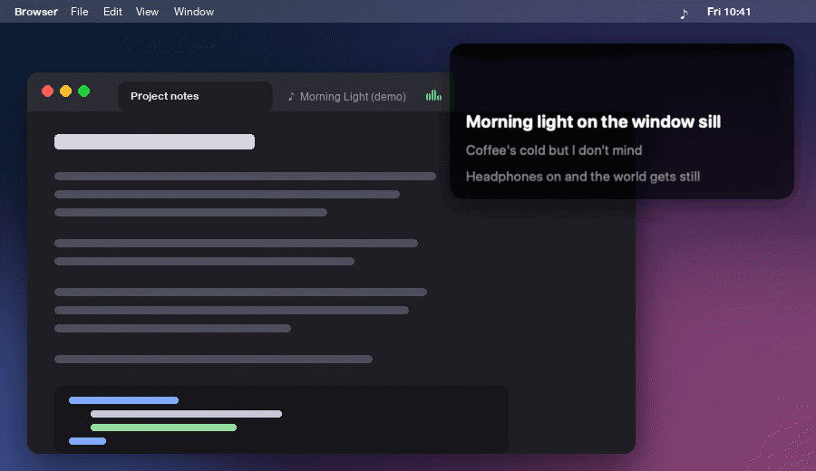
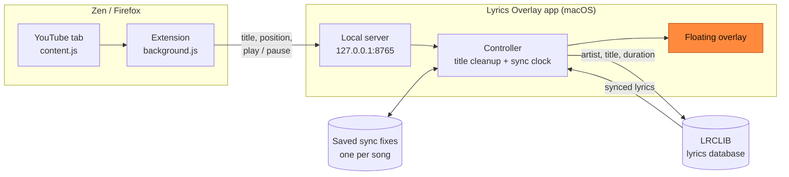

# Lyrics Overlay

Shows synced lyrics for whatever is playing on YouTube / YouTube Music as a floating
macOS overlay (top-right by default), even while the browser is in the background.

**[Latest release](https://github.com/iwandepe/lyrics-overlay/releases/latest)** · [Install](#install) · [How it works](#how-it-works) · [License](#license)

<p align="center">
  
</p>

**Sing along without leaving what you're doing.** The music plays in a background browser tab;
the lyrics follow it in a small floating window you can drag anywhere.

- Synced line by line, even while the browser is in the background
- Hover to move it, switch Auto / Manual scrolling, or click a line to fix sync for that song
- Fixes are remembered per song


## How it works



The music keeps playing in your browser; the extension only reports what's playing. The app finds the lyrics,
keeps its own clock so lines stay in time even when the tab is in the background, and draws the overlay.

## Install

Needs macOS 13 or newer. Release notes and downloads are on the [Releases page](https://github.com/iwandepe/lyrics-overlay/releases/latest). In Terminal:

```
curl -fsSL https://raw.githubusercontent.com/iwandepe/lyrics-overlay/main/install.sh | bash
```

This puts **Lyrics Overlay** in `/Applications` and opens it. A setup guide walks you through adding the
browser extension (Zen, or Firefox 140 or newer) and playing your first song. To remove everything:
`curl -fsSL https://raw.githubusercontent.com/iwandepe/lyrics-overlay/main/install.sh | bash -s -- --uninstall`

Installing the extension by hand: download `lyrics-overlay-bridge.xpi` from the
[latest release](https://github.com/iwandepe/lyrics-overlay/releases/latest), then in Zen or Firefox open
Add-ons → ⚙ → **Install Add-on From File…**.

The app isn't notarized by Apple (that needs a paid developer account), which is why it's installed with
`curl`: files downloaded that way aren't blocked by Gatekeeper. Read `install.sh` first if you like; it's short.

### Updates
The installed app checks for new versions quietly every few hours. When one is out, the menu bar shows **♪•**
and the ♪ menu offers **Update to vX…**. You can also pick **Check for Updates…** any time.
Every update is signed with a key only the maintainer holds, and the app refuses anything that doesn't verify.

## Run from source (development)

1. **App**
   ```
   cd app && ./build.sh && .build/LyricsOverlay
   ```
   A ♪ appears in the menu bar (menu: connection status, corner, show/hide, demo, quit).
   `--demo` shows placeholder lyrics without a browser.

2. **Extension (Zen / Firefox)**
   Open `about:debugging#/runtime/this-firefox` → *Load Temporary Add-on…* → pick
   `extension/manifest.json`. Temporary add-ons are removed when the browser restarts;
   for a permanent install, sign it as an unlisted add-on on addons.mozilla.org.

3. Play a song on YouTube. The menu should say **Extension: connected**.

## Using the overlay
- **Hover** it: it darkens, and a bar appears on top. Everywhere else it's click-through.
- **Move it:** drag the top bar. The position is remembered. (♪ menu → *Move to…* snaps to a corner.)
- **Auto / Manual** (pill in the top bar): *Auto* follows the song; *Manual* lets you scroll the lyrics yourself.
- **Fix sync for one song:** when a line is being sung at a different time than the lyrics say,
  click that line **while you hear it**. The shift is saved for that song in
  `~/Library/Application Support/LyricsOverlay/sync-offsets.json` and reused next time.
  `−` / `+` nudge by 0.25s, the arrow resets. Positive = lyrics shown earlier.

## Tests
`app/run-tests.sh` covers title cleaning, LRC parsing, sync math and saving/restoring per-song fixes.

## Notes
- `build.sh` / `run-tests.sh` use `swiftc` directly (no Xcode/SwiftPM) and include a VFS overlay
  that works around a stale `usr/include/swift/module.modulemap` in some Command Line Tools installs.
- The server only listens on loopback and rejects WebSocket handshakes from web pages.
- Only the cleaned title, artist and duration are sent to LRCLIB.
- The images in `docs/img/` are generated by `docs/make-assets.sh` (scripted offscreen render of the overlay
  with placeholder lyrics, composited onto a mock desktop; needs Pillow). They are not screen recordings.
- Debug: `LYRICS_SNAPSHOT=/path.png LYRICS_SNAPSHOT_AT=5 .build/LyricsOverlay` renders the overlay to a PNG and exits
  (add `LYRICS_FORCE_HOVER=1` for the hovered look). `LYRICS_PORT` / `LYRICS_DATA_DIR` let a test copy run beside your real one.

## License

MIT. See [LICENSE](LICENSE).
